# Orbit

**A fast, modern file manager for Windows 10 and 11 — and Linux.**
Tabs, four views, instant search, previews, archives, split panes, network drives, themes and icon packs — in one calm, keyboard-friendly window.

[**🌐 Visit the Orbit Website**](https://danny19862025.github.io/orbit-file-manager/) · [**⬇ Download the latest release**](https://github.com/danny19862025/orbit-file-manager/releases/latest) · [Report a bug](https://github.com/danny19862025/orbit-file-manager/issues) · [Buy me a coffee](https://buymeacoffee.com/danny1986)

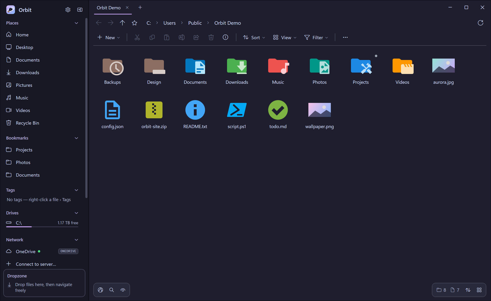

---

## Contents

- [Install](#install) · [Update](#update) · [Uninstall](#uninstall)
- [The main window](#the-main-window) — sidebar, tabs, path bar, command bar, status bar
- [Views](#views) — Grid, Details, Columns, Tree
- [Working with files](#working-with-files) — open, create, copy, move, rename, delete, drag and drop, tags, Properties
- [Find anything](#find-anything-ctrlk) · [Quick preview](#quick-preview-space) · [Split view](#split-view-ctrl)
- [Archives](#archives) · [Disk space map](#disk-space-map) · [Convert](#convert) · [Locked folders](#locked-folders) · [Recycle Bin](#recycle-bin)
- [Network and cloud](#network-and-cloud)
- [Settings](#settings) — Appearance, Icons, General, Network, Shortcuts, About
- [Keyboard shortcuts](#keyboard-shortcuts) · [Command line](#command-line)
- [Where Orbit keeps its data](#where-orbit-keeps-its-data) · [Privacy](#privacy)
- [Build from source](#build-from-source) · [Credits and licence](#credits-and-licence)

---

## Install

Download from the [Releases page](https://github.com/danny19862025/orbit-file-manager/releases/latest):

| File | What it is |
|---|---|
| **`OrbitSetup-<version>.exe`** | The installer — recommended. |
| `Orbit-<version>-win-x64.zip` | Portable copy: unzip anywhere and run `Orbit.exe`. Nothing is installed. |
| `SHA256SUMS.txt` | Checksums, if you want to verify your download. |
| `Orbit-<version>-linux-x64.tar.gz` | **Linux** — unpack and run `./install.sh`. See [Orbit for Linux](linux/README.md). |

**Requirements:** Windows 10 (version 1903 or later) or Windows 11, 64-bit. Nothing else — both downloads include everything Orbit needs, so you don't have to install .NET.

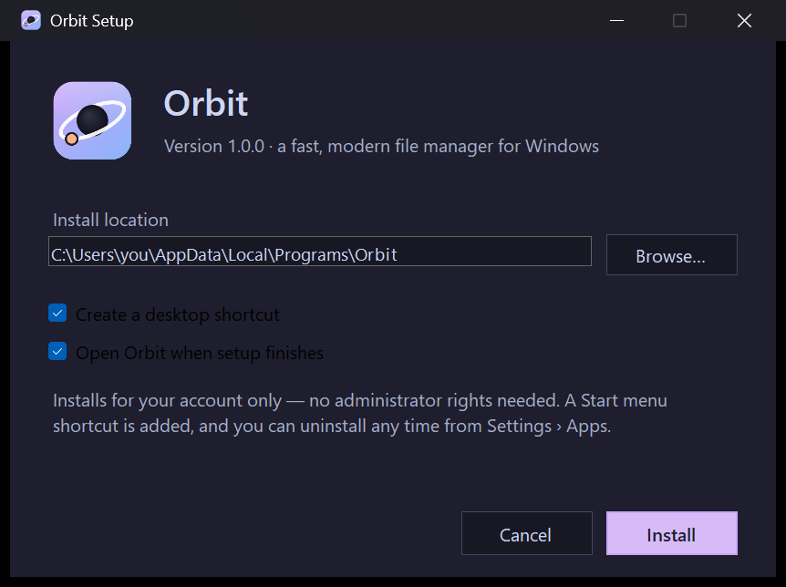

The installer:

- installs **for your account only**, into `%LocalAppData%\Programs\Orbit` by default — **no administrator prompt**;
- adds a **Start menu** shortcut and, if you like, a **desktop** shortcut;
- registers Orbit in **Settings › Apps** so it can be uninstalled like any other app;
- can **open Orbit** when it finishes.

> **Windows SmartScreen:** Orbit isn't code-signed yet, so the first time you run the installer Windows may show
> *“Windows protected your PC”*. Click **More info › Run anyway**. You can check the file against `SHA256SUMS.txt` first.

Silent install (for scripts): `OrbitSetup-<version>.exe /quiet` — add `/dir="D:\Apps\Orbit"` to choose the folder and `/desktop` for a desktop shortcut.

### Linux

Orbit runs on Linux too (KDE Plasma, GNOME and others, x64 or arm64) — the same app with Linux doing the jobs Windows' shell does:
the freedesktop Trash, mounted drives with Eject, GVfs for SMB / WebDAV, your desktop's icon theme, mpv for media previews.
Download the `linux-x64` tarball, then `./install.sh` (no root needed). Details and what's different: **[Orbit for Linux](linux/README.md)**.

## Update

Open **Settings › About › Check for updates**. If a newer release exists, download its installer and run it — it recognises the existing install, shows **Update**, closes Orbit if it's running, replaces the program files and keeps all your settings.

## Uninstall

**Settings › Apps › Installed apps › Orbit File Manager › Uninstall** (or run `Orbit.exe --uninstall`). Orbit asks before removing anything, then asks separately whether to also delete your settings — answer **No** to keep them for a later install. Only the folder the installer created is ever deleted. For the portable copy, just delete its folder.

---

## The main window


### Title bar

- The **Orbit icon** — when Orbit opens, its little moon makes one lap round the planet while the window settles in (skipped if Windows animations are turned off).
- **⚙ Settings** (`Ctrl+,`) and **Hide sidebar**.
- Minimise / maximise / close. Orbit remembers its size and position.

### Sidebar

Drag the divider to resize it. Each section can be collapsed with its arrow, and Bookmarks, Tags, Drives, Network, Recent and Dropzone can be hidden in **Settings › General**.

| Section | What it does |
|---|---|
| **Places** | Home, Desktop, Documents, Downloads, Pictures, Music, Videos and the **Recycle Bin**. **Drag any folder here to pin it**; right-click a pinned place to move it up or down, copy its path or remove it. Drop files on a place to copy or move them there. |
| **Bookmarks** | Folders you starred with ☆ or `Ctrl+D`. |
| **Tags** | Colour tags you've given to files and folders. Click a tag to see everything with it, from any folder. Right-click to remove a tag from all items. |
| **Drives** | Every drive with a usage bar and free space. Right-click a drive for **Analyze disk space**, **Eject** (USB sticks and discs) and Properties. |
| **Network** | Saved servers (SMB, SFTP, WebDAV, Google Drive, Dropbox), detected cloud folders (OneDrive, Google Drive, Dropbox, iCloud) and **Connect to server…** — see [Network and cloud](#network-and-cloud). |
| **Recent** | Folders you visited recently (right-click › *Remove from Recent*). |
| **Dropzone** | A shelf for collecting files while you browse. Drag files onto it, go somewhere else, then drag them out — or right-click › *Copy here* / *Move here*. |

Middle-click a sidebar item to open it in a new tab. Right-click for Open, Open in new tab, Copy path, Open in Terminal, Open in Explorer and Properties.

### Tabs

`Ctrl+T` new tab, `Ctrl+W` close, `Ctrl+Tab` / `Ctrl+Shift+Tab` to switch, middle-click a folder to open it in a new tab. Drop files onto a tab to put them in that tab's folder. **Drag a tab onto the right half of the window to open it in [split view](#split-view-ctrl).** With *Reopen my tabs at startup* on, your tabs come back next time.

### Path bar

- **Back / Forward / Up** (`Alt+←` `Alt+→` `Alt+↑`, or the mouse's back and forward buttons) and **☆ Bookmark**.
- **Breadcrumbs** — click any part to jump there; click a `›` to pick one of its subfolders; drop files on a crumb to put them there.
- Click empty space in the bar (or press `Ctrl+L`) to **type or paste a path** — local folders, `\\server\share` network paths and `sftp://` addresses all work.
- **⟳ Refresh** (`F5`). Folders also refresh on their own when files change.

### Command bar

| Button | |
|---|---|
| **New** | Folder, Text document, Markdown document, JSON file, HTML page, PowerShell script. |
| **Cut · Copy · Paste · Rename · Share · Delete** | The usual file operations. **Share** opens the Windows share sheet. |
| **ⓘ Properties** | Orbit's Properties window — see [Properties](#properties). |
| **Sort** | Name, Date modified, Size, Type; ascending or descending. |
| **View** | Grid, Details, Columns, Tree; Split view; Hidden items; Photo and video thumbnails; Sidebar. |
| **Filter** | By **kind** — Folders, Documents, Pictures, Videos, Music, Archives, Code, Apps and shortcuts — and by **date modified** — Today, Yesterday, Last 7 days, Last 30 days, This year, Older than a year. **Filter by name…** (`Ctrl+F`); **Clear filters** resets. |
| **⋯ More** | Select all / none / invert, Copy path, Add to Dropzone, Open in Terminal, Open in File Explorer, Preview selected, **Analyze disk space…**, **Convert selected…**, Icons and theme…, Properties, Settings. |

### Status bar

Bottom-left: **Search everywhere** (`Ctrl+K`), **Filter this folder** (`Ctrl+F`) and **Show hidden items** (`Ctrl+H`). Bottom-right: how many folders and files are here, what's selected and its total size, and quick sort and view switches.

---

## Views

Switch with **View** or `Ctrl+Shift+1…4`. Each view keeps your sort order and selection.

| | |
|---|---|
| **Grid** — large icons and photo/video thumbnails, colour-tag dots. | 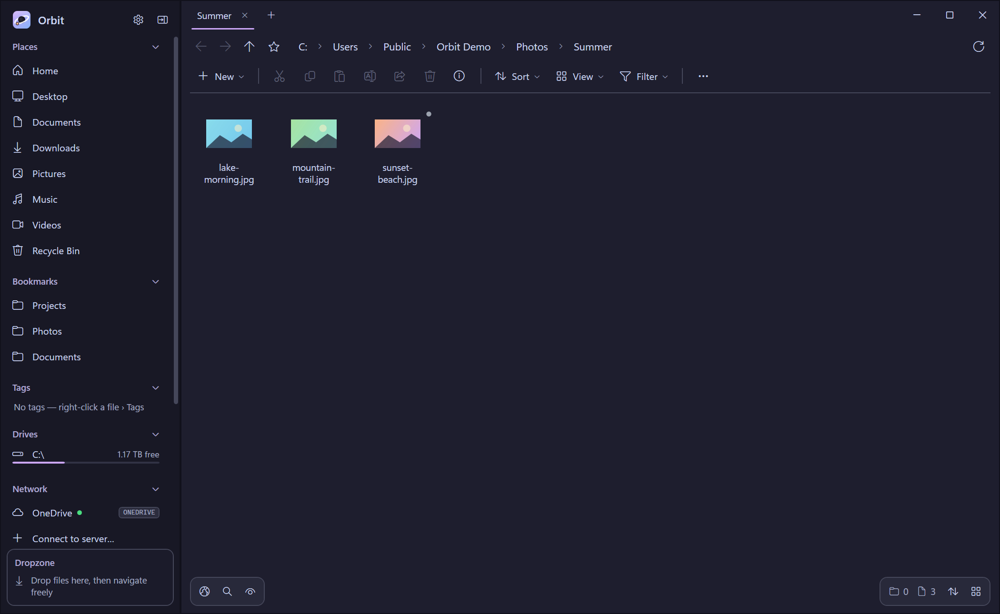 |
| **Details** — name, date, type and size columns; click a header to sort. | 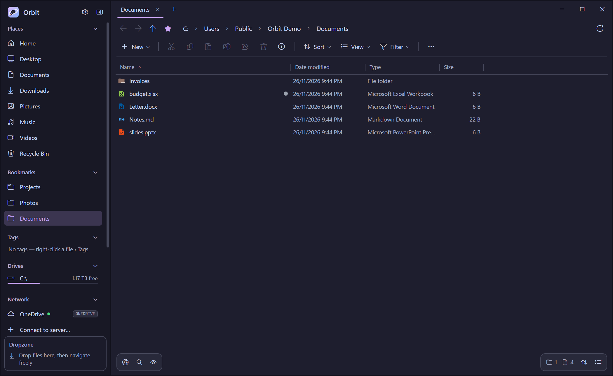 |
| **Columns** — Finder-style Miller columns: each selected folder opens a new column to its right, and the last column previews the selected file. Arrow keys move through the hierarchy. | 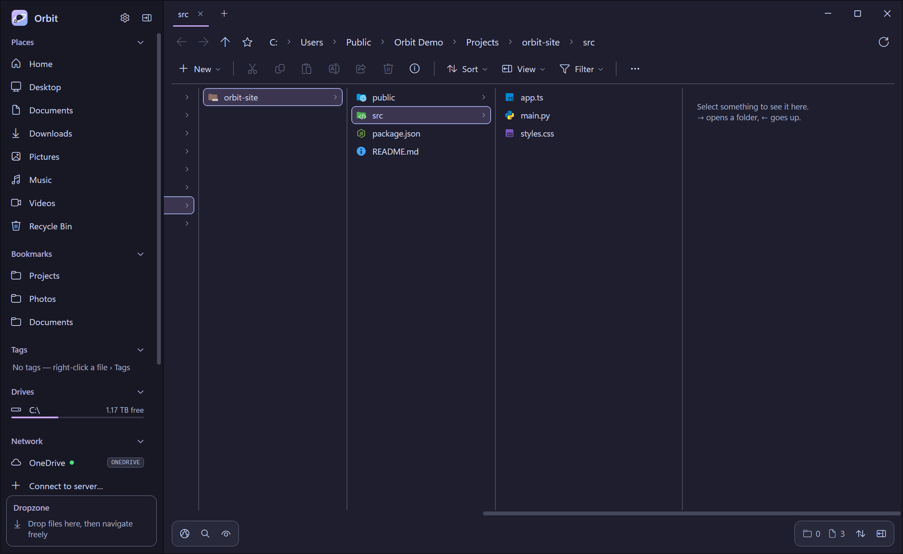 |
| **Tree** — folders expand in place with ▸, so you can see a whole branch at once. | 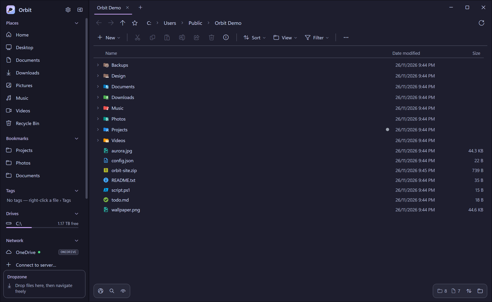 |

**Hidden items:** `Ctrl+H` (or View › Hidden items). **Thumbnails:** with an icon pack active, View › *Photo and video thumbnails* keeps real thumbnails for pictures and videos.

---

## Working with files

- **Open:** double-click or `Enter`. Folders open in place (middle-click: new tab); files open in their default app. Right-click › **Open with…** to choose an app, **Show in folder** for search and tag results.
- **Select:** click, `Ctrl`-click, `Shift`-click, `Ctrl+A`, or **drag a box** on empty space. Type the first letters of a name to jump to it.
- **Create:** New › Folder (`Ctrl+Shift+N`) or a new text, Markdown, JSON, HTML or PowerShell file — Orbit starts renaming it straight away.
- **Copy, cut and paste:** `Ctrl+C`, `Ctrl+X`, `Ctrl+V` — works together with File Explorer. Right-click a folder › *Paste into folder*.
- **Rename:** `F2`.
- **Delete:** `Delete` sends to the Recycle Bin; `Shift+Delete` deletes permanently (Orbit asks first).
- **Copy path:** `Ctrl+Shift+C`.
- **Drag and drop:** onto folders, tabs, breadcrumbs, sidebar places, the Dropzone, the split pane, or other apps. Hold **Ctrl** to copy or **Shift** to move. Hovering over a folder while dragging springs it open.
- **Tags:** right-click › **Tags** to give items colour tags; they show as dots and in the sidebar's Tags section. *Clear tags* removes them.
- **Open in Terminal / Open in Explorer** from the right-click or ⋯ menu.

Copying, moving and deleting go through Windows itself, so you get the normal progress dialog, conflict prompts and undo.

### Properties

`Alt+Enter`, the ⓘ button or right-click › **Properties**. Shows type, location, size (folders are counted in the background), what a folder contains, created / modified / accessed dates, and **Read-only** and **Hidden** switches. **Windows properties…** opens the classic Windows dialog. For a whole drive, Orbit opens the Windows dialog with its used/free chart.

---

## Find anything (`Ctrl+K`)

A search box for **every local drive**. Type part of a name — the search is fuzzy, so `invc 2026` finds `Invoices 2026` — and results are ranked by how well they match. `↑` `↓` to move, `Enter` to open, `Ctrl+Enter` to open in a new tab.

Orbit builds an index of your drives in the background the first time (system folders such as `Windows` and `$Recycle.Bin` are skipped), keeps it up to date as files change, and caches it so later starts are instant.

## Quick preview (`Space`)

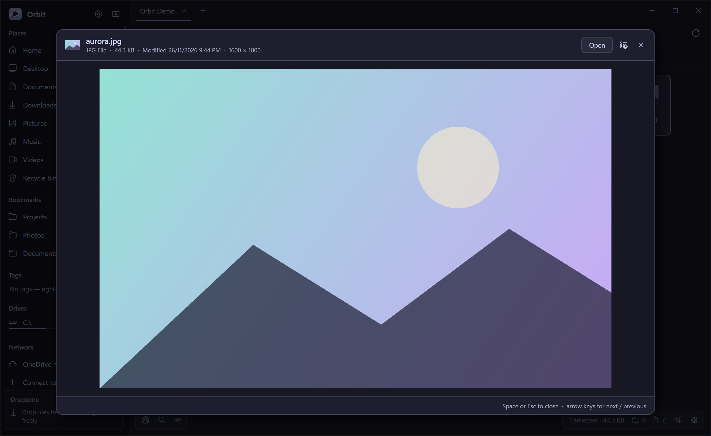

Select a file and press `Space`. `←` `→` move through the folder, `Space` or `Esc` closes, **Open** opens the file.

| Kind | Examples |
|---|---|
| Pictures | jpg, png, gif, bmp, tiff, ico, webp, heic, avif, jxr, dds |
| Text and code | txt, md, json, xml, yaml, toml, ini, log, and source code |
| PDF | pages rendered with Windows' own PDF engine |
| Audio and video | plays inline — mp3, wav, flac, m4a, ogg, opus, mp4, mkv, mov, webm, avi… |
| ZIP | the list of files inside |
| Folders | what's inside |

## Split view (`Ctrl+\`)

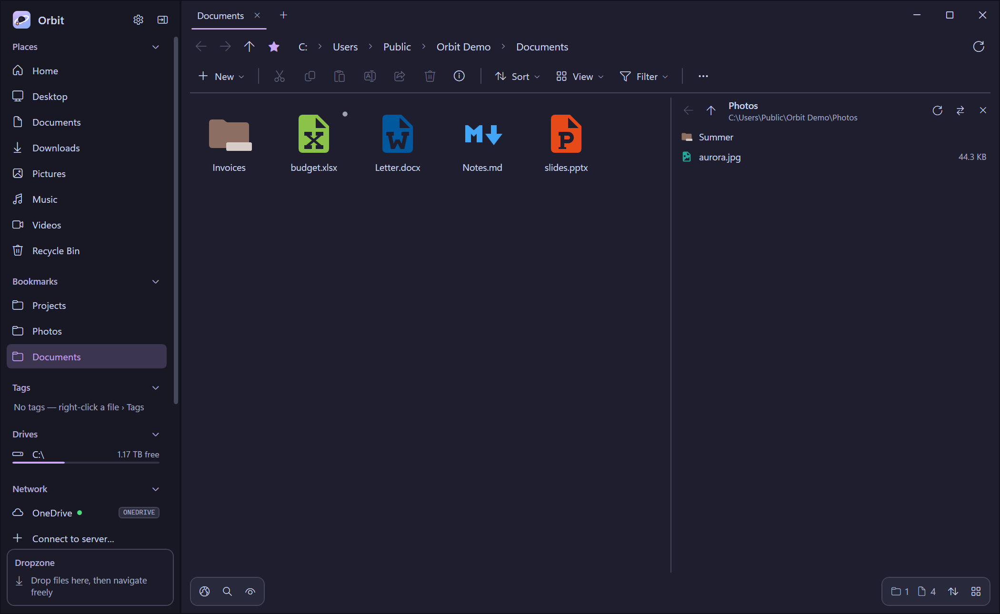

A second pane on the right for moving and copying between two folders. It has its own up, swap and refresh buttons, and the usual keys (`Enter`, `Backspace`, `F5`, `Delete`, `Ctrl+C/X/V`, `Ctrl+Shift+C`, `Alt+Enter`, `Space`). Drag files between panes, drag the divider to resize, or **drag a tab onto the right half** of the window to open it there. Right-click a folder › **Open in split view**; right-click in the pane › *Open in the main pane*.

---

## Archives

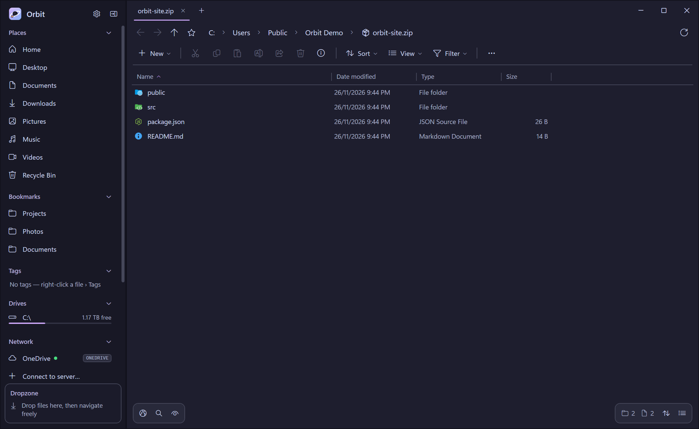

Open **ZIP, RAR, 7z and TAR** (including `.tar.gz`, `.tgz`, `.tar.bz2`, `.tar.xz`) and ZIP-based files such as `.jar`, `.apk`, `.nupkg`, `.vsix`, `.whl` and `.cbz` **like ordinary folders**:

- browse inside, sort, preview and open files (they're extracted to a temporary folder for you);
- **drag files out** or copy them;
- right-click an archive › **Extract to "name\"**, **Extract here**; inside an archive › *Extract to the archive's folder*, *Extract to…*, *Extract everything here / to…*;
- select files and folders › **Compress to ZIP**;
- **ISO, VHD and VHDX** disk images: **Mount** them as a drive, and **Eject** from the sidebar.

Archives are read-only inside Orbit. Password-protected entries are reported clearly instead of failing silently.

## Disk space map

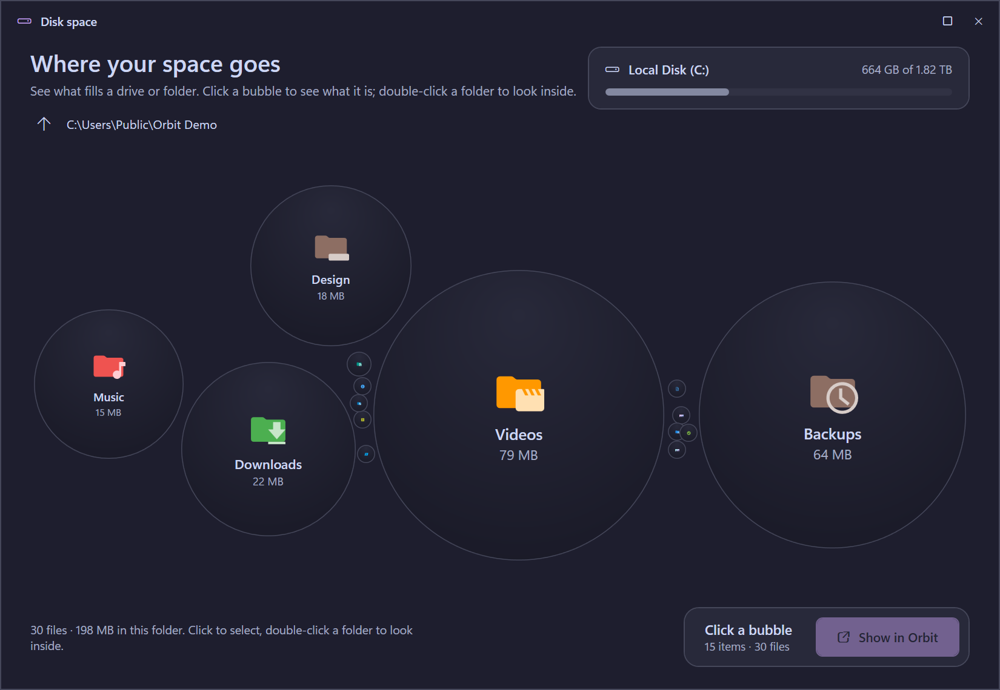

Right-click a drive › **Analyze disk space**, or ⋯ › **Analyze disk space…** for the current folder. Orbit scans in the background and draws the biggest items as bubbles sized by the space they use.

- **Click** a bubble to highlight it — the footer shows its name, size and share of the folder, and the drive bar shows its share of the disk.
- **Double-click** a folder bubble (or right-click › *Look inside*) to drill in; **↑** goes back up.
- **Show in Orbit** brings Orbit to the front with that item, so you can decide what to do with it there.

The map is **read-only** — it never deletes anything.

## Convert

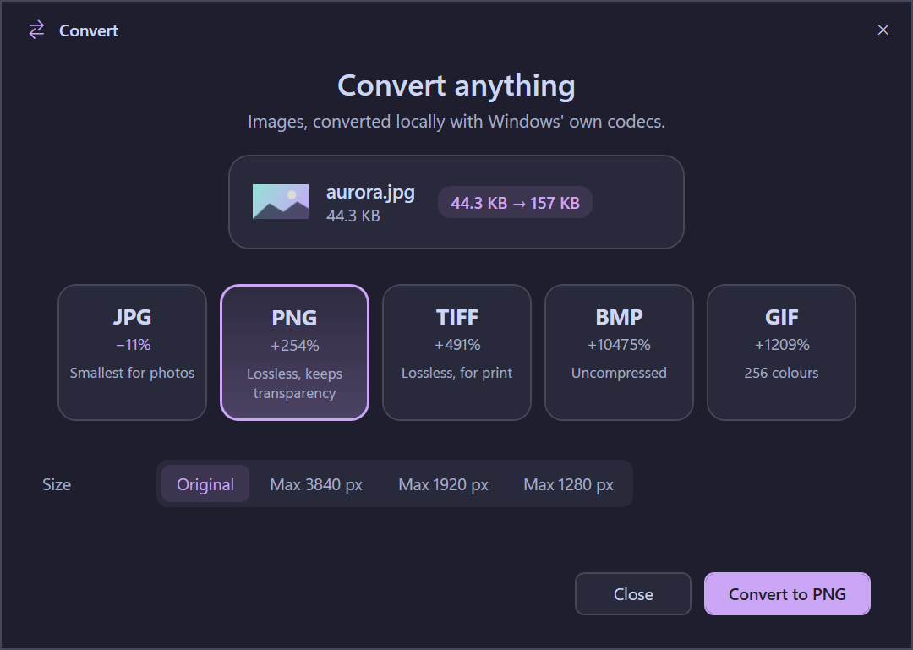

Right-click pictures, videos or audio › **Convert…** (or ⋯ › *Convert selected…*).

- **Pictures** → JPG, PNG, TIFF, BMP or GIF, using Windows' own codecs. Each format card shows a **live estimate** of how much bigger or smaller the result will be. Choose the JPG quality and an optional maximum size (3840, 1920 or 1280 px). Transparent images get a white background in formats without transparency.
- **Video** → MP4 (H.264), WebM (VP9), animated GIF, or MP3 (the audio track). **Audio** → MP3, M4A, OGG or WAV. These use [ffmpeg](https://ffmpeg.org/download.html): Orbit finds it automatically if it's installed (for example `winget install ffmpeg`), and explains how to get it if not.

Converted files are saved next to the originals and **never overwrite anything** (`photo (2).jpg` if needed). Several files of the same kind convert in one go.

## Locked folders

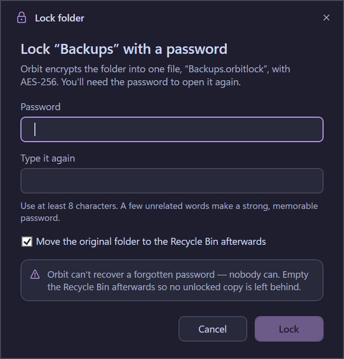

Right-click a folder › **Lock with password…** to turn it into a single encrypted **`.orbitlock`** file. Double-click the file (or right-click › **Unlock…**) and enter the password to get the folder back.

- **AES-256-GCM** encryption in 1 MB chunks, with a key made from your password by **PBKDF2-SHA256 (600,000 iterations)**. Wrong passwords, changed bytes and cut-off files are all detected.
- Nothing is ever written to disk unencrypted, and the password is never stored.
- Before the original folder is touched, Orbit reads the whole locked file back to check it. The original then goes to the **Recycle Bin** (you can untick this) — empty the bin afterwards so no unlocked copy is left.
- Unlocking restores folders, files and modification dates exactly, next to the locked file.
- Orbit refuses to lock whole drives, Windows folders or your entire user folder.

> ⚠️ **A forgotten password cannot be recovered — by anyone.**

## Recycle Bin

Click **Recycle Bin** in Places to browse it inside Orbit. The columns show each item's **original location** and **date deleted**.

- Right-click an item › **Restore** (back to exactly where it was, recreating the folder if needed), **Preview**, **Show original folder**, or **Delete permanently…**
- Right-click empty space › **Restore all items** or **Empty Recycle Bin…** (Windows confirms).
- **Drop files on the Recycle Bin** in the sidebar to delete them.

Orbit reads Windows' own Recycle Bin records, so it always agrees with File Explorer.

---

## Network and cloud

**Connect to server…** (sidebar › Network, or Settings › Network):

| Type | How it works |
|---|---|
| **SMB / Samba** | Windows file shares (`\\server\share`), NAS boxes, Samba on Linux. The connection is made by Windows; Orbit doesn't save the password. |
| **SFTP (SSH)** | Built in. Browse, open, upload (drag in, or *Upload files…*), download (*Download to Downloads / to…*), rename and delete on any SSH server. Password or private key — your `~/.ssh` keys are tried automatically. **Open SSH terminal** from the server's menu. |
| **WebDAV** | Nextcloud, ownCloud and other WebDAV servers, with HTTPS if you like. |
| **Google Drive / Dropbox** | Uses the official desktop app's synced folder when it's installed; otherwise Orbit can mount it as a drive letter with **rclone** and WinFsp (links to both are in the dialog). |

Saved servers appear in the sidebar with a status dot; right-click for Connect, Open in new tab, Edit…, Copy address, Disconnect and Remove from sidebar. **OneDrive, Google Drive, Dropbox and iCloud** sync folders are detected automatically.

**Trusted SSH servers:** the first time you connect to an SFTP server Orbit remembers its identity and warns you if it ever changes. Forget a server in Settings › Network if it was reinstalled.

---

## Settings

Open with ⚙ or `Ctrl+,`. Every change applies instantly and is remembered.

### Appearance

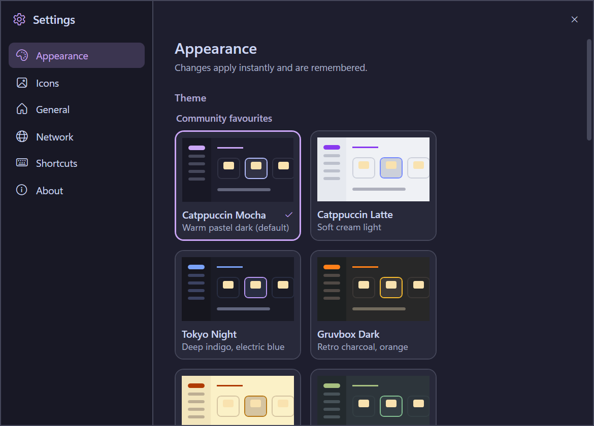

**Themes** — each restyles the whole app:

| Community favourites | Editor classics | Dynamic |
|---|---|---|
| Catppuccin Mocha *(default)* · Catppuccin Latte · Tokyo Night · Gruvbox Dark · Gruvbox Light · Everforest · Kanagawa · Rosé Pine · Nord | One Dark Pro · Monokai Pro · Solarized Dark · Solarized Light · Ayu Dark · Ayu Mirage | **System / Wallpaper** — follows your [pywal](https://github.com/dylanaraps/pywal) palette (`~/.cache/wal/colors.json`) if you use pywal or winwal, otherwise your Windows accent colour and light/dark mode. Updates live when either changes. |

**Window:**

- **Translucent window (Mica)** — lets the Windows 11 acrylic blur show through.
- **Transparency** — 5 % to 90 %. The sidebar stays a little clearer than the file list so names stay readable. Settings, Properties and Orbit's other windows share the same glass.

### Icons

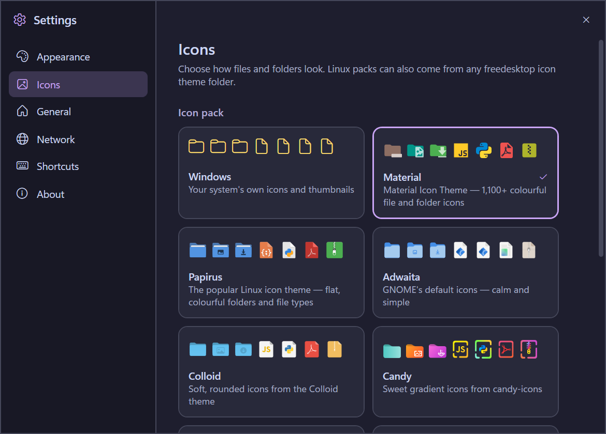

| Pack | |
|---|---|
| **Windows** | Your system's own icons and thumbnails. |
| **Material** *(default)* | Material Icon Theme — 1,100+ colourful file and folder icons. |
| **Papirus · Adwaita · Colloid · Candy** | Popular Linux icon themes. |
| **Phosphor** | Duotone line icons drawn in your theme's colours. |
| **Devicon** | Programming-language and tool logos, with Material for everything else. |
| **Freedesktop theme…** | Point Orbit at **any** Linux icon theme folder (one with `index.theme`, e.g. from gnome-look.org). |

**Previews:** *Keep photo and video thumbnails* shows real thumbnails for media even with an icon pack.

### General

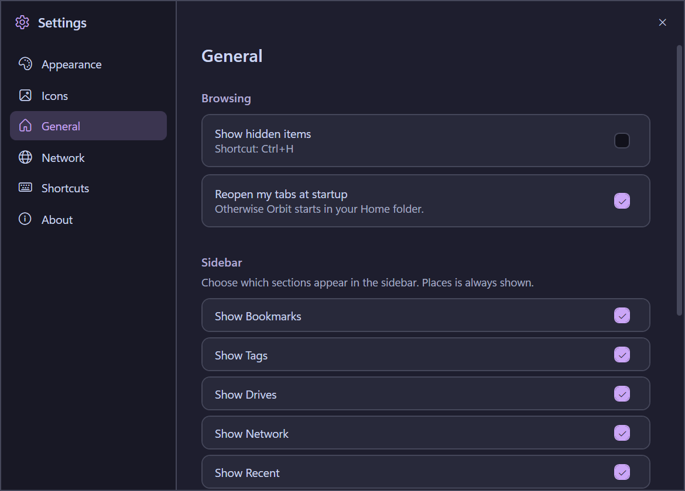

- **Browsing:** Show hidden items, Reopen my tabs at startup.
- **Sidebar:** show or hide Bookmarks, Tags, Drives, Network, Recent and Dropzone (Places is always shown).
- **View:** default layout (Grid, Details, Columns, Tree), sort by Name / Date / Size / Type, sort descending.

### Network

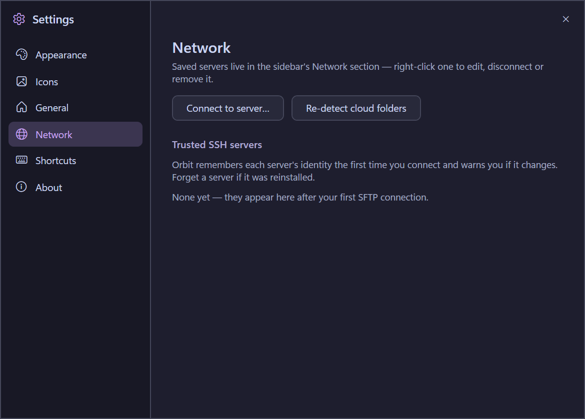

**Connect to server…**, **Re-detect cloud folders**, and the list of **Trusted SSH servers** (with Forget).

### Shortcuts

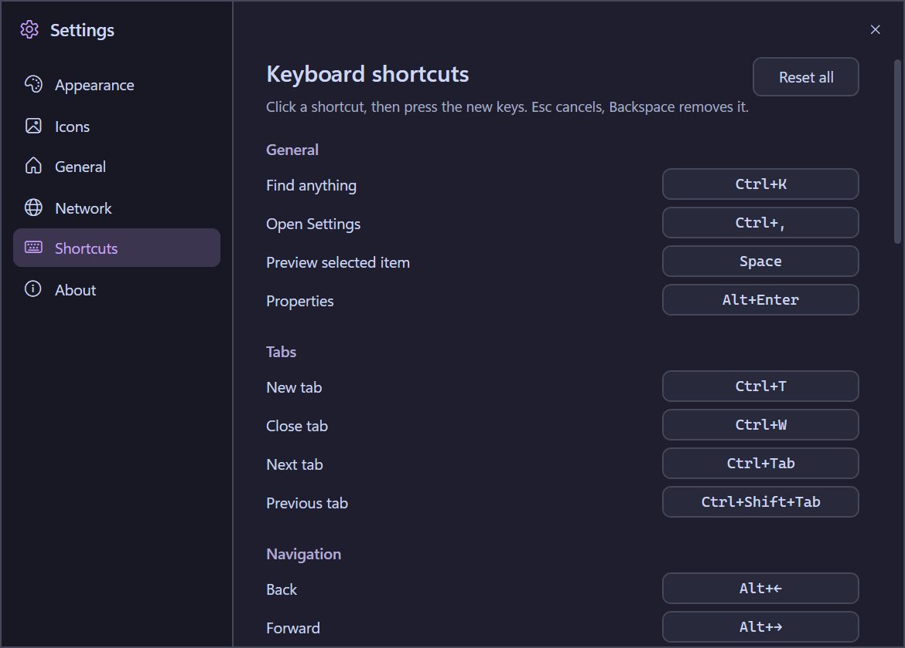

Every shortcut in the table below can be changed: click it and press the new keys (`Esc` cancels, `Backspace` removes it). **Reset all** restores the defaults. The **Fixed** list shows the built-in ones that always work the same way.

### About

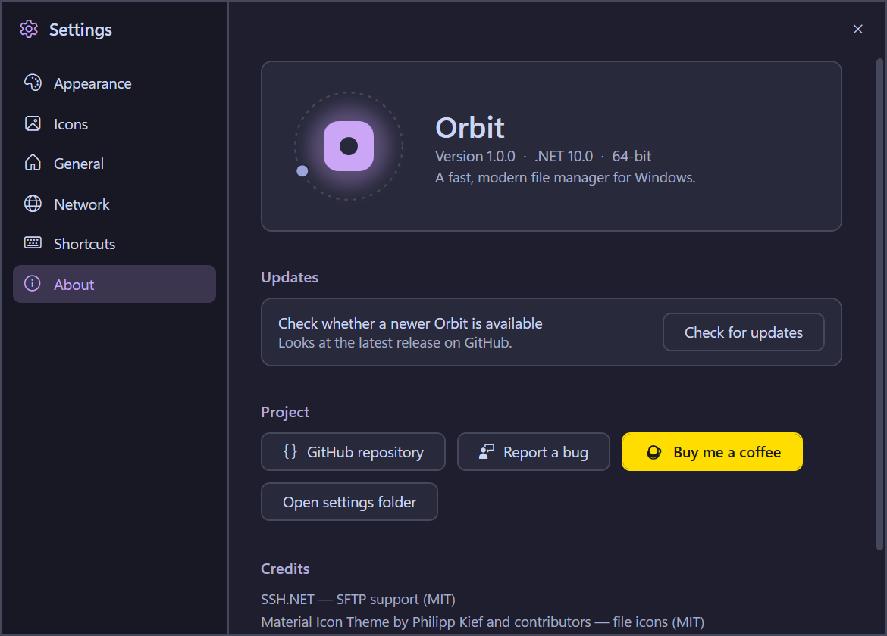

Version, **Check for updates**, links to the **GitHub repository**, **Report a bug**, **Buy me a coffee**, **Open settings folder**, and credits.

---

## Keyboard shortcuts

| General | | Tabs | |
|---|---|---|---|
| Find anything | `Ctrl+K` | New tab | `Ctrl+T` |
| Settings | `Ctrl+,` | Close tab | `Ctrl+W` |
| Preview | `Space` | Next / previous tab | `Ctrl+Tab` / `Ctrl+Shift+Tab` |
| Properties | `Alt+Enter` | | |

| Navigation | | View | |
|---|---|---|---|
| Back / Forward | `Alt+←` / `Alt+→` | Filter this folder | `Ctrl+F` |
| Up one folder | `Alt+↑` | Show / hide hidden items | `Ctrl+H` |
| Type a path | `Ctrl+L` | Grid / Details / Columns / Tree | `Ctrl+Shift+1` … `4` |
| Refresh | `F5` | Split view | `Ctrl+\` |
| Bookmark this folder | `Ctrl+D` | | |

| Files | | Fixed (always the same) | |
|---|---|---|---|
| New folder | `Ctrl+Shift+N` | Open the selected item | `Enter` |
| Rename | `F2` | Back | `Backspace` / mouse back |
| Copy / Cut / Paste | `Ctrl+C` / `Ctrl+X` / `Ctrl+V` | Clear selection or filter | `Esc` |
| Copy path | `Ctrl+Shift+C` | Context menu | `Menu` / `Shift+F10` |
| Delete to Recycle Bin | `Delete` | Open folder in a new tab | Middle-click |
| Delete permanently | `Shift+Delete` | Box-select | Drag on empty space |
| | | Copy / move while dragging | Hold `Ctrl` / `Shift` |

## Command line

```
Orbit.exe [folder or file]           open there (a file is selected in its folder; an archive opens like a folder)
Orbit.exe --preview <file>           open the file's folder and preview it
Orbit.exe --space <folder>           open the disk space map
Orbit.exe --convert <file>           open Convert for a file
Orbit.exe --lock <folder>            lock a folder with a password
Orbit.exe --unlock <file.orbitlock>  unlock a locked folder
Orbit.exe recycle:                   open the Recycle Bin
Orbit.exe --uninstall                uninstall a copy installed with OrbitSetup
```

## Where Orbit keeps its data

| | |
|---|---|
| `%AppData%\Orbit\settings.json` | All settings: tabs, bookmarks, tags, pinned places, saved servers (never passwords), theme, shortcuts… |
| `%AppData%\Orbit\error.log` | Errors, if any — attach it to bug reports. |
| `%LocalAppData%\Orbit\search-index.bin` | The *Find anything* index cache (safe to delete; it's rebuilt). |
| `%LocalAppData%\Programs\Orbit` | The program itself, when installed with the installer. |

## Privacy

Orbit has **no telemetry and no accounts**. It only uses the network when you connect to a server, open a cloud folder, or press **Check for updates** (which asks GitHub for the latest release). Passwords you type for servers or locked folders are never saved by Orbit.

---

## Build from source

Requires Windows and the [.NET 10 SDK](https://dotnet.microsoft.com/download).

```powershell
git clone https://github.com/danny19862025/orbit-file-manager.git
cd orbit-file-manager
dotnet build -c Release
.\bin\Release\net10.0-windows10.0.19041.0\Orbit.exe
```

**Release packages** — builds the self-contained portable zip, the installer and checksums into `dist\`:

```powershell
pwsh -File tools\build-release.ps1
```

The installer (`installer\`) is a small .NET Framework 4.8 app, so it runs on any Windows 10/11 without installing anything. `tools\make-icon.ps1` redraws the app icon (`Assets\orbit.ico`).

**Linux:** `dotnet run --project linux`, and `linux/build-release.sh` for the tarball — see [linux/README.md](linux/README.md).

### Project layout

| | |
|---|---|
| `MainWindow.*.cs` | The main window, split by area: views, sidebar, search, preview, split view, archives, network, drag and drop, tools, Recycle Bin, keys, intro animation. |
| `Themes.cs`, `WallpaperTheme.cs`, `Glass.cs` | Themes, the wallpaper theme and translucency. |
| `IconPack.cs`, `Freedesktop.cs`, `IconService.cs` | Icon packs, shell icons and thumbnails. |
| `Archives.cs`, `FolderLock.cs`, `Converter.cs`, `RecycleBin.cs`, `Network.cs`, `SearchIndex.cs` | Archives, locked folders, conversion, Recycle Bin, network and cloud, search index. |
| `*Window.xaml` | Settings, Properties, Connect, Convert, Lock and Disk space windows. |
| `installer\` | `OrbitSetup.exe`. |
| `linux\` | Orbit for Linux (Avalonia) — a separate project the Windows build never touches. |

---

## Support

If Orbit is useful to you, you can [buy me a coffee](https://buymeacoffee.com/danny1986) ☕ — and [bug reports and ideas](https://github.com/danny19862025/orbit-file-manager/issues) are always welcome.

## Credits and licence

Orbit is released under the [MIT License](LICENSE).

It builds on [SSH.NET](https://github.com/sshnet/SSH.NET) (SFTP), [SharpCompress](https://github.com/adamhathcock/sharpcompress) (archives), [SharpVectors](https://github.com/ElinamLLC/SharpVectors) (SVG icons), the [Material Icon Theme](https://github.com/material-extensions/vscode-material-icon-theme), [Papirus](https://github.com/PapirusDevelopmentTeam/papirus-icon-theme), [Adwaita](https://gitlab.gnome.org/GNOME/adwaita-icon-theme), [Colloid](https://github.com/vinceliuice/Colloid-icon-theme), [candy-icons](https://github.com/EliverLara/candy-icons), [Phosphor](https://github.com/phosphor-icons/core) and [Devicon](https://github.com/devicons/devicon). The Linux icon themes ship as separate files under their own licences (GPL-3.0, LGPL-3.0 / CC BY-SA 3.0) — see [THIRD-PARTY-NOTICES.txt](THIRD-PARTY-NOTICES.txt) and `icons\licenses`.
