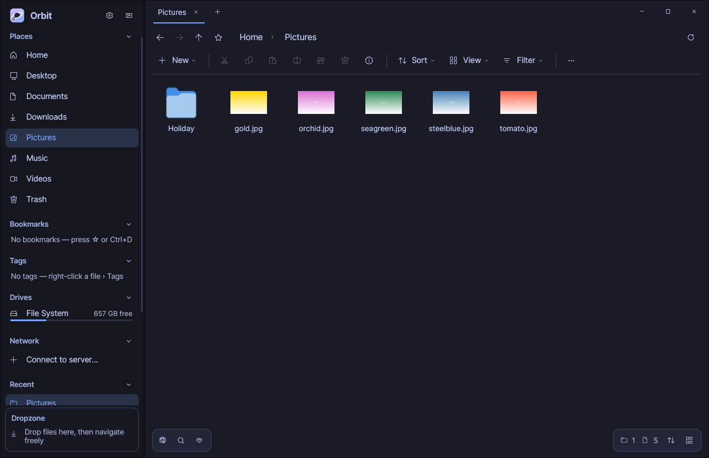

# Orbit for Linux

The Linux edition of Orbit, built with [Avalonia](https://avaloniaui.net/). It is the same app as the Windows version —
same window, views, menus, shortcuts, themes, icon packs, tools and settings format — with Linux doing the jobs that
Windows' shell does on Windows. It lives in its own project here; the Windows app (`../Orbit.csproj`, WPF) never builds
this folder, and this project only shares two platform-neutral files with it (`AppInfo.cs`, `Freedesktop.cs`) plus
the icon packs in `../Assets`.



## Install

Download `Orbit-<version>-linux-x64.tar.gz` from the [Releases page](https://github.com/danny19862025/orbit-file-manager/releases/latest), then:

```sh
tar xf Orbit-*-linux-x64.tar.gz
cd Orbit-*-linux-x64
./install.sh            # for your account only: ~/.local/opt/orbit, app-menu entry, `orbit` command
./install.sh --default  # …and make Orbit the default app for folders
```

Everything Orbit needs is inside the download (no .NET to install). `./uninstall.sh` removes it again
(`--purge` also deletes your settings).

**Optional helpers** that Orbit uses when they're installed — most desktops already have them:

| Tool | Used for |
|---|---|
| `gio` + `gvfs-smb` / `gvfs-dav` | SMB / Samba and WebDAV shares, the Trash fallback |
| `udisks2` (`udisksctl`) | Eject drives, mount ISO / IMG disk images |
| `mpv` | Playing videos and music inside Quick preview |
| `ffmpeg` | Video thumbnails, video / audio conversion, HEIC / AVIF pictures |
| `poppler` (`pdftoppm`, `pdfinfo`) | PDF previews and thumbnails |
| `imagemagick` | Converting pictures to TIFF / BMP / GIF |
| `rclone` + `fuse3` | Mounting Google Drive / Dropbox as a folder |
| `kdeconnect` | Share › Send to your phone |

## What's different from Windows

| On Windows | On Linux |
|---|---|
| Recycle Bin | The freedesktop.org **Trash** (`~/.local/share/Trash` and `.Trash-<uid>` on other drives) — shared with Dolphin, Files and the desktop. Restore, delete permanently, empty. |
| Drive letters | Mounted drives (`/`, `/home`, USB sticks under `/run/media`…) with labels, free space and **Eject** via udisks. |
| Shell copy / move / delete | Orbit's own: progress window, **Replace / Skip / Keep both** for conflicts, same-drive moves are instant renames, permissions, times and symlinks are kept. |
| "Windows" icon pack | **System**: your desktop's icon theme (Breeze, Adwaita, Papirus…) chosen via the shared MIME database, plus thumbnails from `~/.cache/thumbnails` or made by Orbit. |
| Windows properties… | **System properties…** — your file manager's dialog via `org.freedesktop.FileManager1`. Orbit's own Properties adds a **Permissions** row; *Read-only* is the write permission and *Hidden* is the leading dot. |
| Share sheet | **Share** › Send by email, Send to a phone (KDE Connect), Copy as links. |
| Open with… | A list of installed apps (`.desktop` files) for that file type, with *Always use this app*. |
| Mica / acrylic | **Translucent window** asks the compositor for blur (KDE Plasma, Hyprland, picom…). |
| Windows accent colour (System / Wallpaper theme) | pywal, then the **KDE Plasma** or **GNOME** accent colour and light/dark setting — updates live. |
| SMB via Windows, WebDAV via WebClient | **GVfs** (`gio mount`), the same as your file manager; Orbit asks for the password and never saves it. Type `smb://server/share` or `\\server\share` in the path bar. |
| rclone + WinFsp | rclone + FUSE, mounted under `~/.local/share/Orbit/mounts`. |
| MediaElement | **mpv**, embedded in the preview window. |
| Windows PDF engine | **pdftoppm**. |
| New › PowerShell script | New › **Shell script** (executable, with a `#!/usr/bin/env bash` line). |
| Open in Explorer / Terminal | Open in your **file manager** / your **terminal** (`$TERMINAL`, Konsole, GNOME Console, Ptyxis, kitty, Alacritty, Ghostty…). |
| *Find anything* indexes every drive | Indexes `/` and mounted drives but skips system trees (`/usr`, `/proc`, `/var`, `/etc`…), like the Windows folder on Windows; live changes in your own folders. |

Locked folders (`.orbitlock`) use the same format on both systems, so a folder locked on Windows unlocks on Linux and
the other way round.

## Where Orbit keeps its data

| | |
|---|---|
| `~/.config/Orbit/settings.json` | All settings (same format as on Windows). |
| `~/.config/Orbit/error.log` | Errors, if any. |
| `~/.cache/Orbit/search-index.bin` | The *Find anything* index (safe to delete). |
| `~/.local/opt/orbit` | The program, when installed with `install.sh`. |

## Command line

```
orbit [folder | file | smb://… | sftp://… | trash:///]   open there (a file is selected in its folder)
orbit --preview <file>       open the file's folder and preview it
orbit --space <folder>       open the disk space map
orbit --convert <file>       open Convert for a file
orbit --lock <folder>        lock a folder with a password
orbit --unlock <file.orbitlock>
```

## Build from source

Needs the [.NET 10 SDK](https://dotnet.microsoft.com/download).

```sh
dotnet run --project linux                 # run from source
linux/build-release.sh                     # dist/Orbit-<version>-linux-x64.tar.gz (or: linux-arm64)
```

`tools/nested-test.sh OUT SCENARIO` runs Orbit in an isolated virtual KWin session with a throwaway home folder and
scripted steps (see `src/MainWindow.Test.cs`), saving screenshots — handy for checking changes without touching your
desktop. The interface icons are a subset of Microsoft's [Fluent UI System Icons](https://github.com/microsoft/fluentui-system-icons)
(MIT), rebuilt with `Assets/Fonts/make-icon-font.py`.
